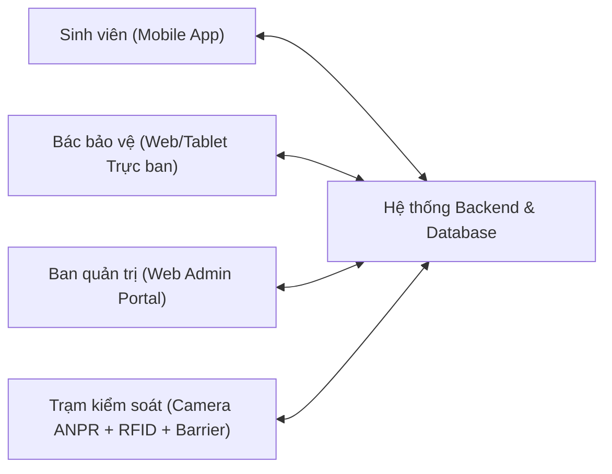
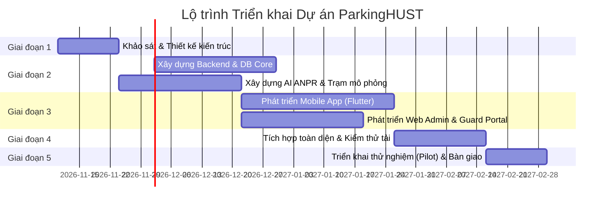

# KẾ HOẠCH XÂY DỰNG DỰ ÁN HỆ THỐNG NHÀ ĐỂ XE THÔNG MINH (PARKING HUST)

> **Dự án:** Smart Campus Parking System (Hệ thống quản lý và hỗ trợ đỗ xe thông minh trong khuôn viên trường đại học)  
> **Phiên bản tài liệu:** 1.0  
> **Ngày lập:** 10/11/2026  
> **Trạng thái:** Bản dự thảo kế hoạch chi tiết (Draft Plan)  

---

## 1. TỔNG QUAN DỰ ÁN

### 1.1. Bối cảnh & Vấn đề giải quyết
* **Tình trạng:** Vào các khung giờ cao điểm (đầu ca học sáng 07h00–07h30 và đầu ca chiều 12h30–13h00), sinh viên tập trung về các nhà xe trung tâm gây ùn tắc kéo dài tại cổng, nhiều nhà xe quá tải trong khi các bãi xa giảng đường lại trống chỗ.
* **Mục tiêu:** 
  1. Minh bạch hóa thông tin số chỗ trống thời gian thực của toàn bộ nhà xe.
  2. Điều phối luồng xe từ xa thông qua gợi ý theo thời khóa biểu và cơ chế giữ chỗ trước có kiểm soát.
  3. Tự động hóa khâu kiểm soát ra/vào (tốc độ qua trạm < 2s/lượt), tăng cường an ninh tài sản và giảm tải áp lực cho nhân viên bảo vệ.

---

## 2. PHẠM VI DỰ ÁN & CÁC PHÂN HỆ

Hệ thống bao gồm 3 phân hệ chính và 1 hệ thống tích hợp trạm phần cứng:

1. **Phân hệ 1 (Mobile App - Sinh viên):**
   * Giám sát bản đồ & chỗ trống thời gian thực.
   * Gợi ý nhà xe theo thời khóa biểu học.
   * Đặt trước chỗ đỗ (giữ slot tối đa 15 phút, tính điểm uy tín).
   * Dẫn đường nội khu khuôn viên trường.
   * Check-in/check-out qua Thẻ sinh viên hoặc Mã QR động.
2. **Phân hệ 2 (Guard Web/Tablet - Trạm trực ban):**
   * Giám sát đối soát biển số xe vào/ra bằng camera AI.
   * Quét mã QR dự phòng khi sinh viên quên thẻ.
   * Mở cưỡng bức barrier trong các ca sự cố ngoại lệ.
3. **Phân hệ 3 (Admin Web Portal - Ban quản lý):**
   * Thiết lập hạn mức bãi đỗ, quota giữ chỗ, khung giờ mở/đóng cửa.
   * Thống kê lưu lượng, biểu đồ nhiệt (Heatmap) giờ cao điểm.
   * Quản lý vi phạm gửi xe qua đêm và tài khoản sinh viên.
4. **Phân hệ 4 (Gate Edge Integration):**
   * Nhận diện biển số (ANPR: YOLOv8 + OCR).
   * Kết nối đầu đọc RFID và relay điều khiển Barrier.

---

## 3. KIẾN TRÚC CÔNG NGHỆ (TECH STACK)

| Thành phần | Công nghệ lựa chọn | Mục đích sử dụng |
| :--- | :--- | :--- |
| **Mobile App** | **Flutter (Dart)** | Đa nền tảng Android/iOS, hiệu năng 60fps, UI bản đồ mượt mà |
| **Bản đồ Mobile** | **Mapbox SDK / Google Maps** | Dựng bản đồ khuôn viên và tuyến đường đi bộ nội khu |
| **Backend Core** | **Node.js (NestJS / TypeScript)** | RESTful API, kiến trúc module hóa chuẩn enterprise |
| **Real-time Server** | **WebSockets (Socket.io)** | Đẩy số chỗ trống tức thời lên Mobile & Web trực ban |
| **Cơ sở dữ liệu** | **PostgreSQL (+ PostGIS)** | Lưu trữ dữ liệu có cấu trúc và tính toán tọa độ không gian |
| **Bộ nhớ đệm & Lock** | **Redis (Redlock & TTL Key)** | Khóa phân tán (tránh race-condition khi giữ chỗ) & tự động hủy slot sau 15p |
| **Admin & Guard Web** | **React.js + TailwindCSS + shadcn/ui** | Giao diện điều hành trực ban và quản trị trường học |
| **Push Notification** | **Firebase Cloud Messaging (FCM)** | Đẩy cảnh báo bãi đầy, nhắc giờ hết hạn giữ chỗ |
| **Nhận diện biển số** | **Python (YOLOv8 + PP-OCR)** | Nhận diện biển số xe máy tốc độ cao tại trạm barrier |

---

## 4. LỘ TRÌNH TRIỂN KHAI (PROJECT ROADMAP & MILESTONES)

Dự án được triển khai trong vòng **16 tuần (4 tháng)** chia làm 5 giai đoạn:

---

## 5. KẾ HOẠCH CÔNG VIỆC CHI TIẾT (WORK BREAKDOWN STRUCTURE - WBS)

### GIAI ĐOẠN 1: KHỞI TẠO & THIẾT KẾ (Tuần 1 - 2)
* [ ] Thu thập số liệu các nhà xe thực tế (sức chứa, vị trí cổng, sơ đồ đi bộ).
* [ ] Thiết kế cơ sở dữ liệu quan hệ (ERD) và sơ đồ kiến trúc hệ thống (System Architecture).
* [ ] Thiết kế UI/UX trên Figma (Đầy đủ luồng Mobile App, Guard Web, Admin Web).
* [ ] Thiết lập môi trường dự án (Monorepo/Git repo, CI/CD, chuẩn coding convention).

### GIAI ĐOẠN 2: PHÁT TRIỂN NỀN TẢNG BACKEND & AI EDGE (Tuần 3 - 6)
* [ ] **Backend Core:**
  * [ ] Xác thực SSO / Auth JWT và phân quyền (Sinh viên, Bảo vệ, Admin).
  * [ ] API Quản lý nhà xe, bãi đỗ, cập nhật vị trí.
  * [ ] Logic giữ chỗ với **Redis Lock** và cơ chế hủy tự động bằng **Redis TTL Expire Event**.
  * [ ] Tích hợp WebSocket Gateway phát số chỗ trống thời gian thực.
* [ ] **AI & Xử lý Trạm barrier:**
  * [ ] Thu thập dataset biển số xe máy và huấn luyện mô hình YOLOv8 nhận diện biển số.
  * [ ] Pipeline trích xuất biển số (OCR) đạt độ chính xác > 95% và độ trễ < 500ms.
  * [ ] Giả lập luồng sự kiện Barrier vào/ra qua giao thức MQTT.

### GIAI ĐOẠN 3: PHÁT TRIỂN ỨNG DỤNG CLIENT (Tuần 7 - 11)
* [ ] **Mobile App (Flutter):**
  * [ ] Module Bản đồ số: Render các nhà xe, trạng thái màu (Xanh/Vàng/Đỏ), đường đi bộ.
  * [ ] Module Giữ chỗ: Đồng hồ đếm ngược 15:00, cảnh báo hủy, quản lý điểm uy tín.
  * [ ] Module Vé xe: Sinh mã QR động (TOTP) và hiển thị thông tin xe đang gửi.
  * [ ] Module Đồng bộ lịch học & Đề xuất điểm đỗ thông minh.
* [ ] **Guard Web Portal:**
  * [ ] Màn hình trực ban 2 camera (làn vào/ra), thông báo cảnh báo sai lệch biển số.
  * [ ] Nút mở barrier khẩn cấp và công cụ quét mã QR cứu hộ.
* [ ] **Admin Web Portal:**
  * [ ] Dashboard báo cáo lưu lượng, tỷ lệ lấp đầy bãi xe.
  * [ ] Cấu hình hạn mức quota giữ chỗ và xử lý xe quá hạn.

### GIAI ĐOẠN 4: TÍCH HỢP HỆ THỐNG & ĐÁNH GIÁ (Tuần 12 - 14)
* [ ] Kết nối toàn diện: Mobile App $\leftrightarrow$ Backend $\leftrightarrow$ Trạm Barrier $\leftrightarrow$ Web Trực ban.
* [ ] Kiểm thử tải (Load Testing): Giả lập 2.000 sinh viên đồng thời truy cập và đặt chỗ vào đầu giờ cao điểm.
* [ ] Kiểm thử luồng ngoại lệ: Rớt mạng Internet tại cổng, sinh viên bỏ slot (no-show), nhận diện biển số mờ.
* [ ] Tối ưu hóa hiệu năng API (latency < 200ms) và tối ưu độ phản hồi WebSockets.

### GIAI ĐOẠN 5: THỬ NGHIỆM THỰC TẾ & BÀN GIAO (Tuần 15 - 16)
* [ ] Triển khai thí điểm (Pilot Run) tại 1 nhà xe thực tế với nhóm 100 sinh viên tình nguyện.
* [ ] Thu thập ý kiến phản hồi người dùng (User Feedback), tinh chỉnh UI/UX.
* [ ] Đóng gói tài liệu kỹ thuật, tài liệu hướng dẫn vận hành cho bảo vệ và sinh viên.
* [ ] Báo cáo nghiệm thu dự án.

---

## 6. MA TRẬN QUẢN TRỊ RỦI RO (RISK MANAGEMENT)

| Rủi ro tiềm ẩn | Mức độ | Biện pháp giảm thiểu |
| :--- | :---: | :--- |
| **Ùn ứ tại cổng giờ cao điểm** | Cao | Ưu tiên quẹt thẻ RFID/NFC (< 1.5s/xe); mã QR chỉ là giải pháp dự phòng thứ cấp. |
| **Tranh chấp slot giữ chỗ vs khách vãng lai** | Cao | Chỉ cấp hạn mức đặt trước 15–20% tổng dung tích; bố trí làn riêng cho xe đặt trước nếu mặt bằng cho phép. |
| **Gian lận/Spam đặt chỗ (No-show)** | Trung bình | Cơ chế trừ điểm uy tín (Karma System), tự động khóa tính năng đặt chỗ 48h nếu no-show quá 2 lần/tuần. |
| **Camera ANPR đọc sai biển số (mưa, bụi bẩn)** | Trung bình | Luôn có bước đối chiếu với mã thẻ RFID; còi báo động bảo vệ can thiệp chỉ mất 3s bấm duyệt tay. |
| **Mất kết nối mạng tại bốt kiểm soát** | Trung bình | Thiết kế cơ chế Local Fallback (trạm kiểm soát lưu cache biển số tạm thời tại chỗ, đẩy đồng bộ lên cloud khi có mạng lại). |

---

## 7. TIÊU CHÍ ĐÁNH GIÁ THÀNH CÔNG (KPIS / METRICS)

1. **Hiệu năng trạm:** Thời gian xe qua cổng trung bình $< 2.5$ giây/xe.
2. **Độ chính xác AI:** Nhận diện đúng biển số xe máy $\ge 95\%$ trong điều kiện ánh sáng tiêu chuẩn.
3. **Độ trễ hệ thống:** Cập nhật số chỗ trống hiển thị trên Mobile App với độ trễ $< 1$ giây so với thực tế bãi.
4. **Tỷ lệ No-show:** Kiểm soát tỷ lệ bỏ chỗ đặt trước $< 8\%$ nhờ hệ thống điểm uy tín.
5. **Trải nghiệm sinh viên:** Giảm thời gian tìm chỗ gửi xe giờ cao điểm từ trung bình 10–15 phút xuống dưới 3 phút.
